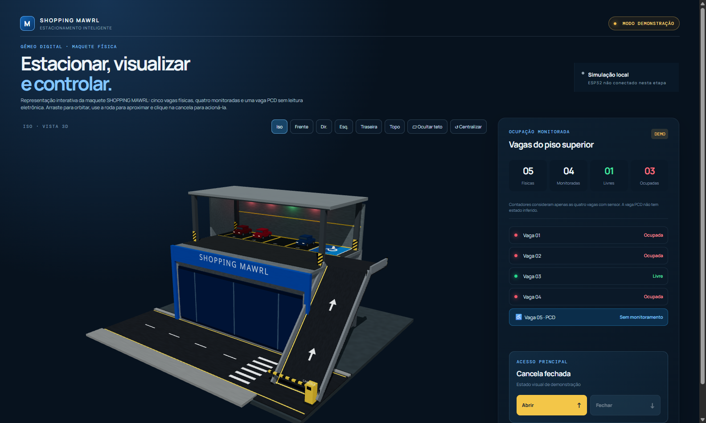

# Shopping MAWRL — Estacionamento Inteligente



O Shopping MAWRL é um protótipo acadêmico desenvolvido no curso Técnico em Desenvolvimento de Sistemas do SENAI. Ele combina uma maquete física de estacionamento com uma aplicação web que apresenta um gêmeo digital 3D interativo da estrutura.

O projeto representa cinco vagas físicas: quatro convencionais monitoradas por sensores ultrassônicos e LEDs RGB, além de uma vaga PCD sem monitoramento eletrônico. Nesta versão, a interface funciona em **modo demonstração local**; a comunicação com o hardware ainda não está conectada à aplicação.

## Objetivo

Demonstrar, de forma visual e didática, como sensores, automação e software podem apoiar a operação de um estacionamento inteligente. O modelo 3D permite observar a maquete, simular o estado das vagas monitoradas e controlar visualmente a cancela.

## O que já está implementado

- Cena 3D interativa construída com React Three Fiber e Three.js;
- Visualização da maquete com fachada, rua, rampa, cobertura, cinco vagas e vaga PCD;
- Rotação, zoom, centralização e vistas isométrica, frontal, laterais, traseira e superior;
- Opção de ocultar e exibir a cobertura;
- Painel de ocupação para as quatro vagas monitoradas;
- Alteração manual dos estados no modo demonstração, refletida em carros, LEDs e contadores;
- Cancela animada, controlável pelos botões ou pelo clique direto no objeto 3D;
- Verificação automática da geometria de circulação no modelo digital.

## Em desenvolvimento

- Comunicação entre o navegador, um serviço local e as ESP32;
- Leitura das quatro vagas físicas em tempo real;
- Envio de comandos reais para a cancela;
- Autenticação, reconexão e indicação de dados desatualizados;
- Validação elétrica e mecânica final da instalação física.

O firmware disponível em [`firmware_original`](firmware_original) foi preservado como referência. Ele não deve ser tratado como firmware final de integração: o sketch da cancela ainda possui alternância automática e nenhum dos dois sketches possui Wi-Fi implementado.

## Tecnologias

- React 19 e TypeScript;
- Vite 7;
- Three.js, React Three Fiber e Drei;
- Arduino/ESP32 para a maquete física;
- PCA9685 para o servo da cancela.

## Arquitetura atual e prevista

```text
Aplicação React (modo demonstração)
  ├─ painel de vagas e controles
  ├─ estado local da demonstração
  └─ cena 3D interativa

Integração física prevista (ainda não implementada)
  ESP32 A (sensores/LEDs) ─┐
                           ├─ serviço local ─ aplicação React
  ESP32 B (cancela/PCA9685)┘
```

Os limites entre a interface e a futura integração estão descritos em [docs/ARQUITETURA.md](docs/ARQUITETURA.md).

## Maquete e vagas

| Vaga | Tipo | Sensor/LED | Estado no painel |
| --- | --- | --- | --- |
| 01 a 04 | Convencional | HC-SR04 e LED RGB | Monitorado no modo demonstração |
| 05 | PCD | Não possui | Não entra nos contadores monitorados |

A rampa, a plataforma superior e o corredor de circulação foram modelados para formar um percurso contínuo até as vagas. As dimensões principais conhecidas foram centralizadas em [`src/config/model.ts`](src/config/model.ts); detalhes sem medição física são estimativas visuais ajustáveis.

## Estrutura do projeto

```text
.
├─ docs/                 documentação técnica e de instalação
├─ firmware_original/    sketches recebidos, preservados sem alteração
├─ public/               arquivos públicos da aplicação
├─ referencias/          fotos e imagens de referência da maquete
├─ scripts/              verificações locais e servidor da versão compilada
├─ src/                  aplicação React, estado e cena 3D
├─ .env.example          orientação segura para variáveis futuras
├─ package.json          scripts e dependências do projeto
└─ pnpm-lock.yaml        versões travadas das dependências
```

As fotos em `referencias/` são material de trabalho da maquete. Elas não precisam ser publicadas automaticamente em um repositório aberto; revise autorização e necessidade antes de incluí-las em uma publicação.

## Requisitos

- Node.js `^20.19.0` ou `>=22.12.0` (o projeto foi verificado com Node.js 24);
- pnpm (recomendado, pois existe `pnpm-lock.yaml`);
- Git, para a alternativa de clonagem;
- Navegador moderno com WebGL para a visualização 3D.

## Instalação e execução local

```bash
pnpm install --frozen-lockfile
pnpm dev
```

O Vite exibirá o endereço local no terminal, normalmente `http://localhost:5173`. Para gerar a versão de produção:

```bash
pnpm build
pnpm preview
```

Outros comandos úteis:

```bash
pnpm check:geometry
```

Esse teste valida, a partir das dimensões configuradas, a continuidade da rota da rua até as cinco vagas no modelo digital. Ele não substitui a validação física da maquete.

## Como usar

1. Arraste na área 3D para orbitar a câmera e use a roda do mouse para aproximar ou afastar.
2. Use as vistas predefinidas e o botão **Centralizar** para reposicionar a câmera.
3. Oculte a cobertura quando quiser observar o estacionamento por cima.
4. Clique nas vagas 01 a 04 no painel para alternar a ocupação de demonstração.
5. Use os botões da cancela ou clique no braço amarelo diretamente na cena.

Todos esses comportamentos são simulações locais nesta etapa. O painel deixa isso explícito para não confundir dados demonstrativos com leituras reais dos sensores.

## Uso no computador do SENAI

Há duas formas de preparar a apresentação:

### A. Clonar pelo GitHub

Depois que o repositório privado for criado e o acesso da equipe for concedido:

```bash
git clone <URL-DO-REPOSITORIO>
cd shopping-mawrl
pnpm install --frozen-lockfile
pnpm dev
```

É necessário ter Node.js compatível, pnpm e acesso ao repositório. Veja o passo a passo completo em [docs/INSTALACAO.md](docs/INSTALACAO.md).

### B. Levar a versão compilada

No computador de preparação:

```bash
pnpm build
```

Leve a pasta `dist` junto com `scripts/serve-dist.mjs` e `scripts/iniciar-dist.cmd`. No computador do SENAI, com Node.js instalado, execute `scripts\\iniciar-dist.cmd`. O script inicia um servidor HTTP local e mostra o endereço para abrir no navegador. Não abra o `dist/index.html` diretamente por duplo clique: uma aplicação Vite deve ser servida por HTTP.

## Hardware

- [Arquitetura](docs/ARQUITETURA.md)
- [Hardware e pinagem](docs/HARDWARE.md)
- [Rede e futura integração](docs/REDE.md)
- [Checklist de testes](docs/TESTES.md)

## Autoria e licença

Projeto acadêmico do curso Técnico em Desenvolvimento de Sistemas do SENAI. Os nomes dos integrantes, turma e orientação não foram incluídos porque não foram informados.

**Licença pendente de definição.** Nenhuma licença foi adicionada ao repositório. Antes de publicar, o grupo deve decidir qual licença — se alguma — representa o uso desejado do código, da documentação e das imagens.
